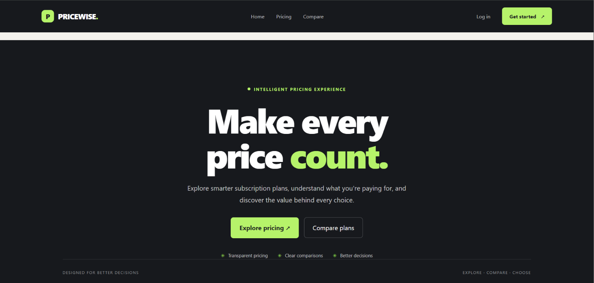
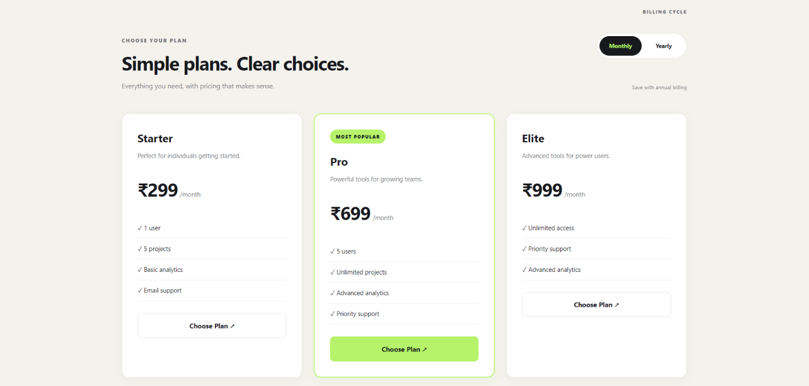
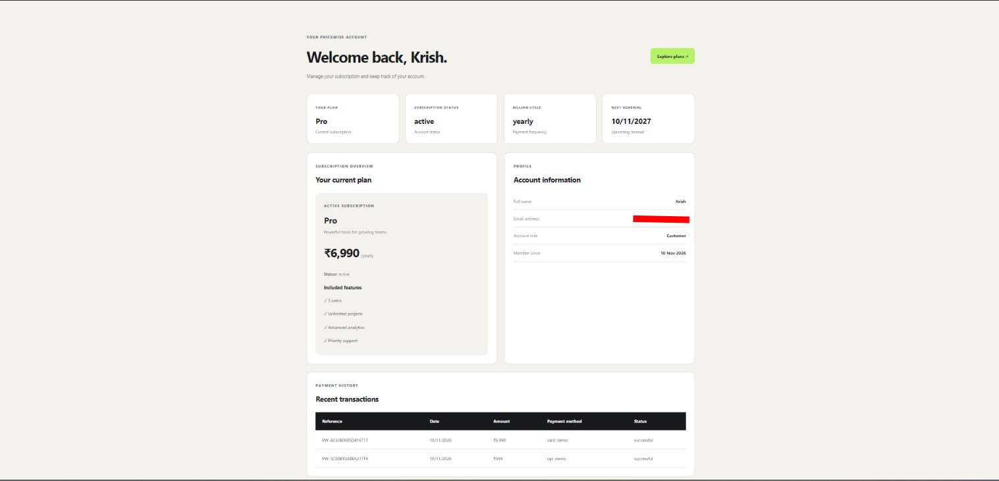
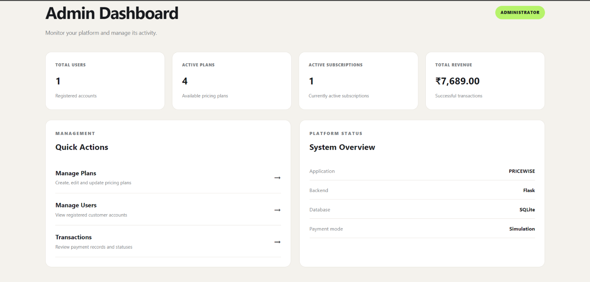

# PRICEWISE

### Pricing & Subscription Management Platform

PRICEWISE is a full-stack web application built to simplify subscription pricing, plan comparison, customer subscriptions, and transaction management.

The platform features a dynamic pricing interface, customer dashboard, simulated checkout workflow, REST API, and an administrative control center.

## Features

**Customer Platform**
- User registration and authentication
- Dynamic monthly and yearly pricing plans
- Subscription plan comparison
- Coupon and discount support
- Simulated subscription checkout
- Customer dashboard
- Subscription and transaction history

**Admin Control Center**
- Admin dashboard with platform statistics
- Create and manage pricing plans
- Edit, activate and deactivate plans
- View registered users
- Monitor transactions and revenue

**REST API**
- Retrieve all active pricing plans
- Retrieve individual plan details
- Authenticated customer dashboard endpoint
- Application health-check endpoint


## Application Preview

### Homepage


### Pricing Plans


### Customer Dashboard


### Admin Dashboard



## Technology Stack

- **Backend:** Python, Flask
- **Frontend:** HTML, CSS, JavaScript
- **Database:** SQLite
- **ORM:** Flask-SQLAlchemy
- **Authentication:** Flask-Login
- **Migrations:** Flask-Migrate
- **API:** Flask JSON endpoints

## Getting Started

### Prerequisites
- Python 3.13 or newer
- Git

### Installation

Clone the repository:

```bash
git clone https://github.com/YOUR_USERNAME/pricewise.git
cd pricewise
```

Create and activate a virtual environment:

```bash
python -m venv venv
venv\Scripts\activate
```

Install dependencies:

```bash
pip install -r requirements.txt
```

Create a `.env` file in the project root:

```env
SECRET_KEY=your-own-random-secret-key
```

Run the application:

```bash
python run.py
```

Open `http://127.0.0.1:5000` in your browser.

## Payment Disclaimer

The checkout workflow is simulated for demonstration purposes. No real payments are processed.

## Future Scope

- Advanced pricing analytics
- Subscription insights and reporting
- Payment gateway integration
- Predictive pricing capabilities

## Author

**Krish Haldankar**

Computer Science & Engineering Student

GitHub: https://github.com/

---

*Developed as a full-stack project exploring web development, backend engineering, database management, authentication, and REST API development.*